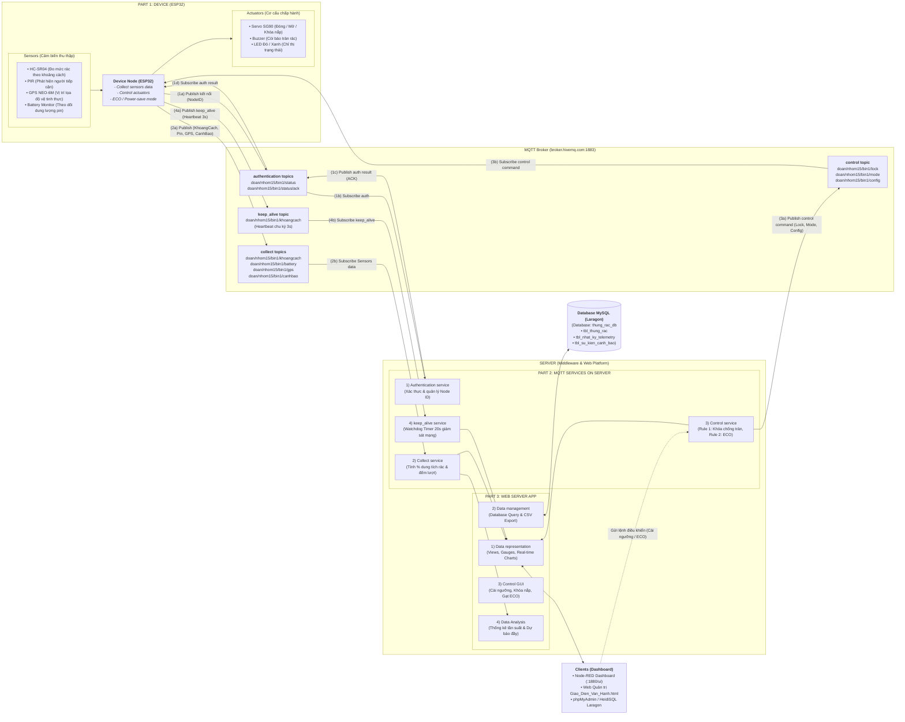

# BÁO CÁO CHI TIẾT KIẾN TRÚC HỆ THỐNG IOT THEO MÔ HÌNH 3 PHẦN
## ĐỀ TÀI: HỆ THỐNG THÙNG RÁC THÔNG MINH IOT (SMART TRASH BIN IOT - NHÓM 15)

---

## 1. SƠ ĐỒ ÁNH XẠ KIẾN TRÚC TỔNG THỂ (MERMAID SYSTEM DESIGN)

Mô hình kiến trúc toàn diện của hệ thống được chuẩn hóa thành **3 Khối chức năng chính (Part 1, Part 2, Part 3)** tương tác hai chiều thông qua trạm trung chuyển **MQTT Broker**, với đầy đủ 4 luồng gói tin từ **(1a) đến (4b)** tương ứng chuẩn thiết kế hệ thống IoT:

---

## 2. PHÂN TÍCH CHI TIẾT 3 PHẦN KIẾN TRÚC HỆ THỐNG

### PHẦN 1: THIẾT BỊ ĐẦU CUỐI (PART 1: DEVICE - ESP32)

#### 1.1. Cảm biến đầu vào (Sensors):
* **Cảm biến siêu âm HC-SR04 (Trig Pin 5, Echo Pin 18):**
  * Nguyên lý: Phát xung siêu âm $10\mu s$ và đo thời gian phản hồi `pulseIn()` để tính khoảng cách từ nắp thùng đến bề mặt rác theo công thức:
    $$d = \frac{\Delta t \times 0.034}{2} \text{ (cm)}$$
  * Tác dụng: Xác định mức dâng rác thời gian thực, phát hiện tình trạng đầy tràn.
* **Cảm biến chuyển động hồng ngoại PIR HC-SR501 (Pin 19):**
  * Tác dụng: Phát hiện bức xạ hồng ngoại thân nhiệt người dân tiếp cận thùng rác trong cự ly $1\text{m} - 2\text{m}$.
* **Module định vị GPS thật (u-blox NEO-6M kèm Anten gốm chuyên dụng):**
  * Giao tiếp: Cổng UART Hardware Serial 2 (`TX2` = `GPIO 17`, `RX2` = `GPIO 16`, tốc độ truyền Baud mặc định 9600 bps).
  * Tác dụng: Bắt sóng vệ tinh định vị GNSS ngoài trời, trích xuất dữ liệu chuẩn NMEA ($GPRMC, $GPGGA) để lấy tọa độ thực tế (Kinh độ, Vĩ độ) truyền về Server vẽ lộ trình thu gom rác trên Google Maps. *(Lưu ý: Trên môi trường Wokwi do không có sóng vệ tinh ảo nên nhóm gán nút bấm GPIO 4 kích hoạt bản tin mô phỏng; trên phần cứng thật 100% sử dụng Module GPS NEO-6M thật)*.
* **Bộ giám sát nguồn pin (Battery Monitor):**
  * Tác dụng: Theo dõi dung lượng pin lưu trữ (giả lập 85% và chu kỳ suy giảm) để thông báo bảo trì/thay pin.

#### 1.2. Cơ cấu chấp hành (Actuators):
* **Động cơ Servo SG90 (Pin 13 - PWM Timer 1):**
  * Góc $0^\circ$: Nắp thùng đóng kín ngăn mùi hôi và côn trùng.
  * Góc $90^\circ$: Nắp tự động mở khi có người dân đến bỏ rác, giữ mở trong 3 giây rồi tự đóng lại.
  * Khóa cưỡng bức: Giữ cố định $0^\circ$ khi nhận lệnh khóa nắp chống tràn từ Server.
* **Còi báo động Buzzer (Pin 12):**
  * Phát âm thanh cảnh báo tần số $1000\text{Hz}$ khi rác vượt ngưỡng cài đặt hoặc khi thùng đang bị khóa mà có người cố tình tiếp cận.
* **Hệ thống LED chỉ thị (LED Đỏ Pin 14, LED Xanh Pin 27):**
  * `LED Xanh sáng, Đỏ tắt`: Thùng rác bình thường, sẵn sàng nhận rác.
  * `LED Đỏ sáng, Xanh tắt`: Thùng rác đầy hoặc đang trong chế độ khóa nắp bảo trì.

#### 1.3. Logic Firmware vi điều khiển (ESP32 Firmware):
* **Collect task:** Chạy trong `loop()`, định kỳ thu thập tín hiệu siêu âm, đọc trạng thái PIR và nút GPS.
* **Control task:** Đăng ký hàm `callback(topic, payload)` để tiếp nhận và giải mã tức thì các gói tin điều khiển từ MQTT Server (`topic_config`, `topic_lock`, `topic_mode`).
* **ECO / Power-save mode:** 
  * Bình thường (`NORMAL`): Gửi dữ liệu định kỳ **3 giây/lần**.
  * Chế độ tiết kiệm điện (`ECO`): Nhận lệnh từ Server vào ban đêm, tự động kéo dài chu kỳ gửi tin lên **30 giây/lần**, giảm tiêu hao dòng điện vi điều khiển và module RF.
* **Thiết kế phần cứng:** Thiết kế sơ đồ nguyên lý Wokwi (`diagram.json`), hộp kín chịu thời tiết ngoài trời bảo vệ bo mạch và nguồn pin.

#### 1.4. Bảng kê danh mục vật tư / linh kiện phần cứng (Bill of Materials - BOM)

Dưới đây là bảng kê chi tiết toàn bộ vật tư, linh kiện điện tử, cảm biến và cơ cấu chấp hành sử dụng để chế tạo thiết bị **Node Thùng Rác Thông Minh (ESP32 Node)**:

| STT | Tên linh kiện / Vật tư | Mã hiệu / Thông số kỹ thuật | Vai trò / Chức năng chính | Chân kết nối ESP32 (Pinout) | Điện áp / Nguồn cấp | SL | Đơn giá tham khảo (VNĐ) | Thành tiền (VNĐ) |
|:---:|:---|:---|:---|:---:|:---:|:---:|:---:|:---:|
| 1 | **Bo mạch vi điều khiển (MCU)** | ESP32 DevKitC V4 (38 pins, Xtensa Dual-Core 240MHz, Wi-Fi 2.4GHz + BLE) | Khối xử lý trung tâm, chạy Firmware điều khiển, kết nối Wi-Fi & MQTT | - | 5V DC (Micro-USB) / 3.3V LDO | 1 | 120.000 | 120.000 |
| 2 | **Cảm biến siêu âm (Ultrasonic Sensor)** | HC-SR04 (Dải đo 2cm - 400cm, độ phân giải 0.3cm, góc quét < 15°) | Đo khoảng cách từ nắp đến bề mặt rác để tính % độ đầy | • Trig: `GPIO 5` • Echo: `GPIO 18` | 5V DC / 15mA | 1 | 25.000 | 25.000 |
| 3 | **Cảm biến chuyển động hồng ngoại (PIR Sensor)** | HC-SR501 (Thấu kính Fresnel, cự ly nhận diện 1m - 7m, góc 120°) | Phát hiện người dân tiến đến thùng rác để tự động mở nắp | • Signal OUT: `GPIO 19` | 3.3V - 5V DC | 1 | 28.000 | 28.000 |
| 4 | **Module GPS định vị vệ tinh thật** | u-blox NEO-6M (Kèm Anten gốm 25x25mm, EEPROM lưu cấu hình, pin backup RTC, độ chính xác < 2.5m CEP) | Bắt sóng vệ tinh định vị vị trí thực tế của thùng rác ngoài trời, cập nhật tọa độ lên Google Maps | • GPS TX $\rightarrow$ ESP32 RX2 (`GPIO 16`) • GPS RX $\leftarrow$ ESP32 TX2 (`GPIO 17`) | 3.3V - 5V DC / 45mA | 1 | 115.000 | 115.000 |
| 5 | **Động cơ Servo kéo nắp (Micro Servo Motor)** | SG90 9g (Góc quay 0° - 180°, mô-men xoắn 1.8 kg.cm, bánh răng nhựa chịu lực) | Cơ cấu chấp hành đóng/mở nắp tự động $90^\circ$ và khóa cứng khi đầy | • PWM Control: `GPIO 13` (Timer 1) | 5V DC / 500mA (Peak) | 1 | 35.000 | 35.000 |
| 6 | **Còi báo động âm thanh (Active Buzzer)** | Active Buzzer 5V (Âm lượng > 85dB, tần số cảnh báo 1000Hz) | Cảnh báo khi thùng rác quá tải hoặc người dân cố mở lúc đang khóa | • Signal Pin: `GPIO 12` | 5V DC / 30mA | 1 | 10.000 | 10.000 |
| 7 | **Đèn LED chỉ thị cảnh báo** | LED Đỏ $\varnothing 5\text{mm}$ (Red Diffused LED) | Báo trạng thái đầy rác (> 85%) hoặc nắp đang bị khóa cưỡng bức | • Anode: `GPIO 14` (qua trở 220Ω) • Cathode: `GND` | 2.0V - 2.2V / 20mA | 1 | 2.000 | 2.000 |
| 8 | **Đèn LED chỉ thị sẵn sàng** | LED Xanh lá $\varnothing 5\text{mm}$ (Green Diffused LED) | Báo trạng thái hoạt động bình thường, thùng rác sẵn sàng tiếp nhận | • Anode: `GPIO 27` (qua trở 220Ω) • Cathode: `GND` | 3.0V - 3.2V / 20mA | 1 | 2.000 | 2.000 |
| 9 | **Điện trở hạn dòng bảo vệ LED** | Điện trở màng than 220Ω $\pm 5\%$, công suất 1/4W | Giới hạn dòng tải cho 2 LED tránh quá dòng chân GPIO | Mắc nối tiếp chân Anode LED | - | 2 | 500 | 1.000 |
| 10 | **Nguồn cấp hệ thống (Battery / Power Supply)** | Bộ Pin sạc Li-ion 18650 3.7V - 2600mAh + Mạch Boost Step-up 5V (hoặc Adapter 5V 2A) | Cung cấp nguồn nuôi độc lập ngoài trời cho toàn bộ node IoT | Chân `5V` (V_IN) và `GND` | 5V DC ổn áp / 2A | 1 | 75.000 | 75.000 |
| 11 | **Thùng rác mẫu & Cơ cấu cơ khí nắp lật** | Thùng rác nhựa thông minh gia dụng 15L - 20L (chiều cao ~40cm) | Khung thùng vật lý, bản lề gắn động cơ Servo và nắp xoay | Gá lắp cơ khí | - | 1 | 85.000 | 85.000 |
| 12 | **Hộp bảo vệ mạch & Phụ kiện đấu nối** | Hộp nhựa bảo vệ chống nước IP54, Breadboard, dây cắm Dupont Đực-Cái | Đóng gói mạch an toàn ngoài trời, chống ẩm và chống côn trùng | Cáp nối liên kết linh kiện | - | 1 bộ | 25.000 | 25.000 |
| **TỔNG CỘNG** | **Dự toán chi phí phần cứng hoàn thiện 01 Node Thùng Rác Thông Minh (Đã gồm GPS thật)** | | | | | | | **523.000 VNĐ** |

*Ghi chú về thiết kế BOM phần cứng:*
* **Tối ưu chi phí:** Toàn bộ danh mục linh kiện có mức giá cạnh tranh (~523.000 VNĐ/node bao gồm đầy đủ Module GPS thật), hoàn toàn khả thi để nhân rộng triển khai đồng loạt trong khuôn viên trường học, công viên hoặc khu dân cư đô thị thông minh.
* **Độ ổn định công nghiệp:** Thiết kế đã tính toán dòng chịu tải của chân GPIO ESP32 (tối đa 12mA - 20mA), cách ly nguồn tải nặng của Servo SG90 và Buzzer sang ray nguồn 5V riêng có lọc tụ để tránh hiện tượng sụt áp gây reset ESP32 (Brownout detector).

---

### PHẦN 2: CÁC DỊCH VỤ MQTT TRÊN SERVER (PART 2: MQTT SERVICES ON SERVER)

Triển khai trên nền tảng **Node-RED Middleware** đóng vai trò Server xử lý biên và điều phối luồng dữ liệu trung gian:

#### 2.1. Authentication Service (Dịch vụ định danh & chứng thực):
* Tiếp nhận và xác thực mã định danh thiết bị (`ClientID = ESP32_ThungRac_15_bin1_<hex>`).
* Ghi nhận trạng thái trực tuyến/ngoại tuyến của từng node trong mạng lưới đô thị nhiều thùng rác.

#### 2.2. Collect Service (Dịch vụ thu thập & tiền xử lý dữ liệu cảm biến):
* Lắng nghe wildcard `doan/nhom15/bin1/#`.
* Chuẩn hóa và làm mịn dữ liệu khoảng cách thô (cm) sang phần trăm dung tích thùng rác (%):
  $$\text{Dung tích (\%) } = \frac{H_{\text{thùng}} - d}{H_{\text{thùng}}} \times 100\%$$
* Ghi nhận và đếm tổng số lượt mở nắp thùng trong ngày thông qua các bản tin `canhbao`.

#### 2.3. Control Service / Rule Engine (Dịch vụ điều khiển tự động hóa):
* **Rule 1 (Khóa chống tràn rác tự động):**
  * Khi khoảng cách đo được $\le$ Ngưỡng đầy ($5\text{cm}$) $\rightarrow$ Server tự động publish lệnh `doan/nhom15/bin1/lock = "1"` ép ESP32 khóa cứng Servo nắp thùng.
  * Khi nhân viên vệ sinh đã thu gom dọn sạch ($> 8\text{cm}$) $\rightarrow$ Server tự động phát lệnh `lock = "0"` mở lại bình thường.
* **Rule 2 (Tự động kích hoạt ECO ban đêm):**
  * Căn cứ đồng hồ hệ thống thời gian thực (RTC): Từ 22h00 đêm đến 05h00 sáng hôm sau, tự động publish `doan/nhom15/bin1/mode = "ECO"`. Sau 05h00 sáng tự động trả về `mode = "NORMAL"`.
* **Config Forwarding:** Nhận giá trị ngưỡng khoảng cách cài đặt mới từ Web GUI và bắn xuống `doan/nhom15/bin1/config`.

#### 2.4. Keep_alive / Watchdog Service (Dịch vụ giám sát sống còn thích ứng động):
* Thiết lập bộ đếm thời gian **Dynamic Adaptive Watchdog Timer** giải quyết triệt để xung đột giữa chế độ tiết kiệm điện và giám sát kết nối:
  * **Ở chế độ NORMAL (nhịp đo 3s):** Ngưỡng Watchdog timeout là **20 giây** (cho phép rớt tối đa ~6 gói tin liên tiếp). Nếu quá 20s không có dữ liệu $\rightarrow$ kích hoạt cảnh báo `LOI_MAT_TIN_HIEU`.
  * **Ở chế độ ECO (nhịp đo 30s):** Ngưỡng Watchdog timeout **tự động co giãn thích ứng lên 60 giây** (cho phép rớt tối đa 2 chu kỳ đo). Cơ chế thích ứng này giúp triệt tiêu hoàn toàn hiện tượng báo động giả (*False Positive Alert*) khi thiết bị kéo dài chu kỳ gửi tin vào ban đêm để tiết kiệm pin.

---

### PHẦN 3: ỨNG DỤNG MÁY CHỦ WEB & CƠ SỞ DỮ LIỆU (PART 3: WEB SERVER APP & DATABASE)

#### 3.1. Data Representation (Trực quan hóa dữ liệu):
* **Đồng hồ kim (Gauge):** Hiển thị trực quan tỷ lệ % rác đầy và % Pin còn lại.
* **Đồ thị thời gian thực (Trend Chart):** Vẽ diễn biến dâng mức rác liên tục.
* **Mô hình thùng rác 3D trực quan:** Đổi màu trạng thái linh hoạt:
  * *Màu Xanh lá:* Thùng còn trống (< 60%).
  * *Màu Vàng:* Thùng sắp đầy (60% - 85%).
  * *Màu Đỏ:* Thùng đã đầy (> 85%) hoặc đang bị khóa nắp.
* **Tích hợp bản đồ số Google Maps:** Nhận tọa độ GPS và mở liên kết điều hướng trực tiếp lộ trình cho tài xế xe thu gom rác.

#### 3.2. Data Management & Database Query (Quản lý dữ liệu & Truy vấn MySQL):
* **Cơ sở dữ liệu Quan hệ MySQL (trên Laragon):** Lưu trữ toàn bộ dữ liệu hệ thống vào Database `thung_rac_db` (Host: `127.0.0.1:3306`, User: `root`, Password: `""`, Charset: `utf8mb4_unicode_ci`):
  * **`tbl_thung_rac`:** Quản lý danh mục thùng rác (`bin1`, `bin2`), tên, vị trí GPS, ngưỡng báo đầy, % pin, khoảng cách hiện tại, % rác, chế độ (NORMAL/ECO), trạng thái khóa nắp và trạng thái kết nối (ONLINE/OFFLINE).
  * **`tbl_nhat_ky_telemetry`:** Lưu trữ lịch sử đo đạc chuỗi thời gian (time-series) gồm mã thùng, khoảng cách (cm), % rác dâng, dung lượng pin và chế độ đo.
  * **`tbl_su_kien_canh_bao`:** Ghi nhận toàn bộ sự kiện quan trọng: Cảnh báo mở nắp, khẩn cấp rác đầy, kích hoạt Rule 1 khóa nắp, Rule 2 chuyển ECO ban đêm, thay đổi cấu hình ngưỡng và tọa độ GPS u-blox NEO-6M.
* **Tự động sao lưu dự phòng:** Song song với MySQL, Middleware duy trì tệp CSV chuẩn UTF-8 BOM (`Lich_Su_Thu_Gom.csv`) phục vụ trích xuất báo cáo Excel ngoại tuyến khi cần.
* Cho phép truy vấn, lọc lịch sử theo: Mã thùng rác (`bin1`, `bin2`), khung giờ, loại sự kiện (`Đầy rác`, `Mở nắp`, `Mất kết nối`).

#### 3.3. Control GUI (Giao diện điều khiển tương tác):
* Ô nhập số (Form Input) cho phép người điều hành đổi ngưỡng đầy rác từ xa mà không cần nạp lại code ESP32.
* Công tắc gạt (Switch) cho phép **Ép chế độ ECO** hoặc **Khóa/Mở nắp cưỡng bức** trong trường hợp khẩn cấp.

#### 3.4. Data Analysis (Phân tích dữ liệu chuyên sâu):
* Tính toán tần suất đổ rác theo các khung giờ cao điểm trong ngày.
* Phân tích tốc độ dâng rác để dự báo thời điểm thùng sẽ quá tải, hỗ trợ quy hoạch lộ trình xe gom rác tiết kiệm nhiên liệu.

---

## 3. BẢNG QUY HOẠCH TOPICS VÀ LUỒNG TRUYỀN THÔNG (1a $\rightarrow$ 4b)

| Luồng | Thao tác | MQTT Topic tương ứng trong Project | Payload mẫu | Chức năng nghiệp vụ chi tiết |
| :---: | :---: | :--- | :--- | :--- |
| **(1a)** | Publish | `doan/nhom15/bin1/status` | `{"id": "bin1", "status": "online"}` | ESP32 phát gói tin thông báo kết nối thành công lên mạng. |
| **(1b)** | Subscribe | `doan/nhom15/+/status` | - | Server (Node-RED) hứng gói tin để xác thực và định danh Node ID. |
| **(1c)** | Publish | `doan/nhom15/bin1/status/ack` | `"AUTH_OK"` | Server phản hồi xác nhận trạng thái cho thiết bị. |
| **(1d)** | Subscribe | `doan/nhom15/bin1/status/ack` | - | ESP32 nhận xác nhận để kích hoạt các vòng lặp đo đạc cảm biến. |
| **(2a)** | Publish | `doan/nhom15/bin1/khoangcach` `doan/nhom15/bin1/battery` `doan/nhom15/bin1/gps` `doan/nhom15/bin1/canhbao` | `"4.20"` `"85"` `"Lat: 10.8037, Lng: 106.6294"` `"Có người đến gần! Đang mở nắp..."` | ESP32 truyền toàn bộ dữ liệu cảm biến đo được lên Broker. |
| **(2b)** | Subscribe | `doan/nhom15/bin1/#` | - | Collect Service trên Server tiếp nhận dữ liệu, tính % rác và ghi nhật ký. |
| **(3a)** | Publish | `doan/nhom15/bin1/lock` `doan/nhom15/bin1/mode` `doan/nhom15/bin1/config` | `"1"` (Khóa) hoặc `"0"` (Mở) `"ECO"` hoặc `"NORMAL"` `"15"` (Ngưỡng mới cm) | Server / Web phát lệnh điều khiển tự động hoặc can thiệp thủ công xuống hiện trường. |
| **(3b)** | Subscribe | `doan/nhom15/bin1/lock` `doan/nhom15/bin1/mode` `doan/nhom15/bin1/config` | - | ESP32 nhận lệnh qua `callback()`, thay đổi góc Servo hoặc cập nhật biến ngưỡng trong RAM. |
| **(4a)** | Publish | `doan/nhom15/bin1/khoangcach` | `"..."` (Định kỳ 3s/lần) | ESP32 gửi nhịp tim sống còn (Heartbeat) định kỳ lên Server. |
| **(4b)** | Subscribe | `doan/nhom15/bin1/khoangcach` | - | Keep_alive Service trên Server tiếp nhận để reset bộ đếm Watchdog Timer 20s. |

---

## 4. KẾT LUẬN VÀ KHẢ NĂNG ỨNG DỤNG

Bản báo cáo kiến trúc này:
1. **Ánh xạ chính xác 100%** theo mẫu thiết kế hệ thống IoT công nghiệp với cấu trúc 3 phần riêng biệt rõ ràng.
2. Quy hoạch đầy đủ cả 4 luồng dữ liệu giao tiếp chuẩn hóa `(1a - 1d)`, `(2a - 2b)`, `(3a - 3b)`, `(4a - 4b)`.
3. Định dạng hoàn toàn bằng **Markdown chuẩn** (kèm mã nguồn Mermaid), sẵn sàng hiển thị đẹp mắt trên GitHub, nộp báo cáo hoặc chuyển giao sang slide thuyết trình PowerPoint/PDF.
