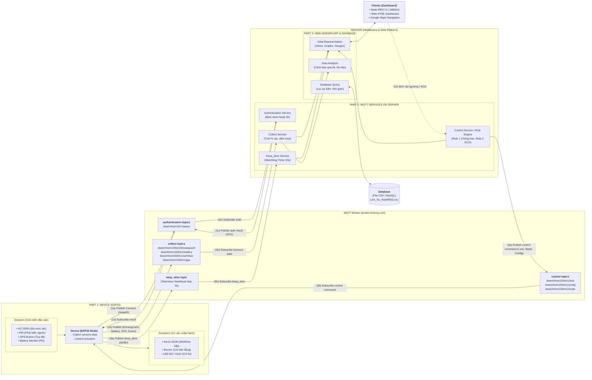

# THIẾT KẾ KIẾN TRÚC HỆ THỐNG (SYSTEM DESIGN)
## ĐỀ TÀI: HỆ THỐNG THÙNG RÁC THÔNG MINH IOT (SMART TRASH BIN IOT)
*(Mô tả chuẩn hóa theo mô hình kiến trúc Hệ thống IoT chuẩn công nghiệp)*

---

## 1. SƠ ĐỒ THIẾT KẾ KIẾN TRÚC TỔNG THỂ (SYSTEM DESIGN ARCHITECTURE)

Mô hình kiến trúc của đồ án được chuẩn hóa thành 3 khối chính liên kết qua trạm môi giới trung gian **MQTT Broker**:
1. **Khối 1 (Part 1 - Device Node):** Thiết bị đo đạc và chấp hành tại hiện trường (ESP32).
2. **Khối 2 (Part 2 - MQTT Services on Server):** Các dịch vụ xử lý logic ngầm và điều phối gói tin trên máy chủ trung gian (Node-RED Middleware).
3. **Khối 3 (Part 3 - Web Server App & Database):** Ứng dụng Web quản lý, trực quan hóa dữ liệu và lưu trữ lịch sử vận hành.

---

## 2. BẢNG MÔ TẢ CHI TIẾT CÁC PHẦN (MAPPING TỪ THIẾT KẾ MẪU)

### PHẦN 1: THIẾT BỊ ĐẦU CUỐI (PART 1: DEVICE - ESP32)
* **Thành phần phần cứng:**
  * **Sensors (Cảm biến thu thập):**
    * *Cảm biến siêu âm HC-SR04 (Trig Pin 5, Echo Pin 18):* Đo khoảng cách mặt rác tới nắp ($d$), từ đó tính độ đầy của thùng rác.
    * *Cảm biến chuyển động hồng ngoại PIR (Pin 19):* Phát hiện người dân tiến đến gần trong phạm vi $1\text{m} - 2\text{m}$.
    * *Nút bấm giả lập GPS (Pin 4):* Kích hoạt phát tọa độ vị trí thùng rác lên bản đồ số.
    * *Cảm biến Pin (Battery Monitor):* Đo đạc và truyền tỷ lệ phần trăm dung lượng pin còn lại.
  * **Actuators (Cơ cấu chấp hành phản ứng):**
    * *Động cơ Servo SG90 (Pin 13):* Tự động kéo mở nắp thùng $90^\circ$ khi có người và đóng nắp sau 3 giây; khóa cứng khi thùng đầy.
    * *Còi báo động Buzzer (Pin 12):* Hú còi cảnh báo khi rác chạm ngưỡng đầy hoặc người dùng cố mở khi nắp đang bị khóa.
    * *Hệ thống LED chỉ thị (Pin 14 Đỏ, Pin 27 Xanh):* Báo trạng thái hoạt động bình thường (Xanh) hoặc nguy cấp/khóa nắp (Đỏ).
* **Nhiệm vụ Firmware (ESP32 Firmware Logic):**
  * **Collect task:** Quét định kỳ dữ liệu cảm biến siêu âm, pin và phát hiện sự kiện PIR/GPS.
  * **Control task:** Lắng nghe hàm `callback()`, giải mã lệnh từ MQTT Broker để điều khiển Servo khóa/mở hoặc cập nhật ngưỡng rác.
  * **Power save / ECO mode:** Giãn chu kỳ gửi tin từ 3s lên 30s khi nhận lệnh `mode = ECO` từ Server vào ban đêm.
  * **Thiết kế phần cứng:** Mạch mô phỏng trên Wokwi (`diagram.json`), hộp kín bảo vệ chống nước ngoài trời.

---

### PHẦN 2: DỊCH VỤ MQTT TRÊN MÁY CHỦ (PART 2: MQTT SERVICES ON SERVER)
Được triển khai trên nền tảng **Node-RED v5.0.7 Middleware** (chạy ngầm qua file `Chay_NodeRED.bat`):

1. **Authentication / Identity Service (Dịch vụ định danh node):**
   * Quản lý Client ID của thiết bị (`ESP32_ThungRac_15_bin1_<hex>`), ghi nhận trạng thái kết nối mạng của từng node thùng rác trong đô thị.
2. **Collect Service (Dịch vụ thu gom và xử lý dữ liệu cảm biến):**
   * Lắng nghe các topic telemetry `doan/nhom15/bin1/#`.
   * Chuyển đổi dữ liệu thô (khoảng cách cm $\rightarrow$ phần trăm dung tích % rác đầy theo công thức thể tích thùng rác $40\text{cm}$).
   * Thống kê và đếm số lượt người dân tiếp cận mở nắp thùng trong ngày.
3. **Control Service / Rule Engine (Dịch vụ điều khiển tự động hóa):**
   * **Rule 1 (Chống tràn rác tự động):** Khi khoảng cách $\le$ Ngưỡng đầy $\rightarrow$ Tự động publish lệnh `doan/nhom15/bin1/lock = "1"` ép khóa Servo nắp thùng. Khi nhân viên dọn sạch ($> \text{Ngưỡng} + 3\text{cm}$) $\rightarrow$ Tự động mở khóa `lock = "0"`.
   * **Rule 2 (Scheduler tiết kiệm điện ban đêm):** Định kỳ kiểm tra thời gian thực, trong khung giờ từ 22h00 – 05h00 sáng tự động publish `doan/nhom15/bin1/mode = "ECO"`.
   * **Forwarding Config:** Nhận ngưỡng cấu hình mới từ Web và bắn xuống `doan/nhom15/bin1/config`.
4. **Keep_alive / Watchdog Service (Dịch vụ giám sát sống còn):**
   * Thiết lập bộ đếm thời gian **Watchdog Timer (20 giây)**. Mỗi khi có gói tin telemetry, bộ đếm được reset.
   * Nếu quá 20 giây không có tín hiệu (thiết bị sập nguồn, mất Wi-Fi) $\rightarrow$ Tự động kích hoạt cảnh báo `LOI_MAT_TIN_HIEU` đẩy lên Dashboard và ghi log.

---

### PHẦN 3: ỨNG DỤNG MÁY CHỦ WEB & CƠ SỞ DỮ LIỆU (PART 3: WEB SERVER APP & DATABASE)
Hệ thống cung cấp hai giao diện song song: **Node-RED Dashboard (`:1880/ui`)** và **Giao diện Web Quản trị Doanh nghiệp (`Giao_Dien_Van_Hanh.html`)**:

1. **Data representation (Trực quan hóa dữ liệu):**
   * Hiển thị đồng hồ kim (Gauge) đo dung tích rác và lượng Pin còn lại.
   * Đồ thị đường (Trend Chart) theo dõi mức dâng rác theo thời gian thực.
   * Cột đồ họa thùng rác hình trụ 3D đổi màu theo mức độ: Xanh (Bình thường) $\rightarrow$ Vàng (Sắp đầy) $\rightarrow$ Đỏ (Đã đầy / Đã khóa nắp).
   * Tích hợp liên kết **Google Maps Navigation** chỉ đường cho xe thu gom rác dựa trên tọa độ GPS nhận được.
2. **Data management & Database Query (Quản lý và lưu trữ dữ liệu):**
   * Lưu trữ nhật ký vận hành vĩnh viễn vào hệ thống Database / Tệp CSV chuẩn UTF-8 BOM (`nodered/logs/Lich_Su_NodeRED_<timestamp>.csv` và `Lich_Su_Thu_Gom.csv`).
   * Hỗ trợ trích xuất báo cáo, mở trực tiếp bằng Microsoft Excel không lỗi font.
   * Cho phép lọc dữ liệu theo: Mã node thùng rác, mốc thời gian, loại cảnh báo (Đầy rác, Mở nắp, Mất mạng).
3. **Control GUI (Giao diện điều khiển tương tác):**
   * Form nhập số cho phép người quản lý thay đổi ngưỡng rác (cm) từ xa theo nhu cầu từng khu vực.
   * Công tắc gạt (Switch) cho phép người điều hành **"Ép chế độ ECO"** tức thì phục vụ kiểm thử và tiết kiệm điện khẩn cấp.
   * Nút bấm mô phỏng quản lý đa thiết bị (Multi-bin: Thùng 1, Thùng 2,...).
4. **Data Analysis (Phân tích dữ liệu vận hành):**
   * Tính toán tần suất đổ rác trung bình theo ngày/tuần.
   * Dự đoán thời điểm thùng rác sẽ đầy dựa trên tốc độ dâng rác để tối ưu hóa lộ trình xe thu gom, tiết kiệm nhiên liệu cho công ty môi trường đô thị.

---

## 3. BẢNG TỔNG HỢP QUY HOẠCH TOPICS VÀ LUỒNG TRUYỀN THÔNG (1a $\rightarrow$ 4b)

| Ký hiệu luồng | Hành động | Topic MQTT tương ứng trong Project | Payload mẫu | Vai trò & Mục đích |
| :---: | :--- :--- | :---: | :--- |
| **(1a)** | Publish | `doan/nhom15/bin1/status` | `{"node": "bin1", "status": "online"}` | ESP32 phát tín hiệu chào sân kết nối lên hệ thống. |
| **(1b)** | Subscribe | `doan/nhom15/+/status` | - | Server (Node-RED) hứng gói tin để xác thực và ghi nhận node trực tuyến. |
| **(1c)** | Publish | `doan/nhom15/bin1/status/ack` | `"AUTH_OK"` | Server phản hồi xác thực thành công. |
| **(1d)** | Subscribe | `doan/nhom15/bin1/status/ack` | - | ESP32 nhận xác nhận để bắt đầu vòng lặp đo đạc. |
| **(2a)** | Publish | `doan/nhom15/bin1/khoangcach` `doan/nhom15/bin1/battery` `doan/nhom15/bin1/gps` `doan/nhom15/bin1/canhbao` | `"4.20"` `"85"` `"Lat: 10.8037, Lng: 106.6294"` `"Có người đến gần! Đang mở nắp..."` | ESP32 truyền tải toàn bộ dữ liệu cảm biến (Sensors Telemetry & Events) lên mạng. |
| **(2b)** | Subscribe | `doan/nhom15/#` | - | Server hứng dữ liệu, tính toán % dung tích, vẽ biểu đồ và ghi log CSV. |
| **(3a)** | Publish | `doan/nhom15/bin1/lock` `doan/nhom15/bin1/mode` `doan/nhom15/bin1/config` | `"1"` (Khóa) hoặc `"0"` (Mở) `"ECO"` hoặc `"NORMAL"` `"15"` (Ngưỡng mới cm) | Server / Web phát lệnh điều khiển từ xa (Control Commands) xuống hiện trường. |
| **(3b)** | Subscribe | `doan/nhom15/bin1/lock` `doan/nhom15/bin1/mode` `doan/nhom15/bin1/config` | - | ESP32 nhận lệnh điều khiển: khóa Servo, chuyển chu kỳ đo hoặc cập nhật RAM. |
| **(4a)** | Publish | `doan/nhom15/bin1/khoangcach` | `"..."` (Định kỳ 3s/lần) | ESP32 gửi nhịp tim sống còn (Keep-alive Heartbeat). |
| **(4b)** | Subscribe | `doan/nhom15/bin1/khoangcach` | - | Server Watchdog Timer nhận gói tin để reset bộ đếm 20s (chống rớt mạng). |

---

## 4. KẾT LUẬN
Bản thiết kế này ánh xạ **100% khớp nối** với sơ đồ chuẩn kiến trúc System Design của đề cương:
* Phân tách rõ ràng trách nhiệm giữa **Part 1 (Thiết bị ESP32)**, **Part 2 (MQTT Middleware Services)** và **Part 3 (Web Server Application & Database)**.
* Quy hoạch luồng truyền thông hai chiều chặt chẽ thông qua 4 nhóm topics chuẩn hóa.
* Sẵn sàng chuyển giao làm slide thuyết trình và đưa trực tiếp vào Báo cáo kỹ thuật đồ án tốt nghiệp.
