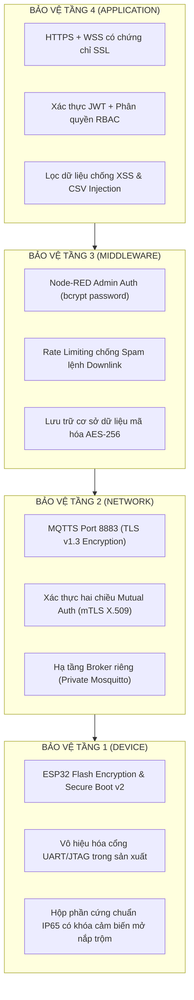

# BÁO CÁO PHÂN TÍCH NGUY CƠ BẢO MẬT, KỊCH BẢN TẤN CÔNG & 10 ĐIỂM OWASP
**Đề tài:** Hệ thống Thùng rác thông minh quản lý tập trung qua mạng lưới IoT (Smart Trash Bin IoT)  
**Nhóm thực hiện:** Nhóm 15  
**Mục đích:** Đánh giá an toàn thông tin toàn diện trên 4 tầng kiến trúc IoT, nhận diện các mối đe dọa thực tế, đối chiếu theo khung chuẩn **OWASP IoT Top 10** & **OWASP Web Top 10**, và đề xuất giải pháp phòng vệ (Security Hardening).

---

## 1. ĐẶC THÙ HỆ THỐNG & BỀ MẶT TẤN CÔNG (ATTACK SURFACE)

Hệ thống Thùng rác thông minh có các đặc thù vận hành mở:
1. **Thiết bị đặt ngoài không gian công cộng (Unattended Physical Devices):** Thùng rác đặt tại công viên, đường phố, trường học; không có người giám sát liên tục.
2. **Kênh truyền thông không dây (Wireless Communication):** Dữ liệu truyền qua sóng Wi-Fi/Internet tới MQTT Broker công cộng.
3. **Hai chiều điều khiển (Bidirectional Control):** Không chỉ gửi telemetry (uplink) mà còn nhận lệnh tác động vật lý (downlink: khóa nắp Servo, đổi cấu hình ngưỡng).
4. **Bề mặt tấn công trải dài trên 4 tầng:**
   * *Tầng 1 (Physical/Sensing):* Cổng nạp UART, cảm biến, cơ cấu chấp hành.
   * *Tầng 2 (Network):* Kênh truyền MQTT, đường truyền Wi-Fi.
   * *Tầng 3 (Middleware):* Cổng dịch vụ Node-RED (1880), tệp dữ liệu CSV.
   * *Tầng 4 (Application):* Giao diện Web Dashboard, kết nối WebSocket.

---

## 2. NGUY CƠ BẢO MẬT VÀ CÁC KỊCH BẢN TẤN CÔNG THỰC TẾ

```
[Kẻ tấn công]
    │
    ├── (1) Tấn công vật lý ───────► Cạy nắp thùng, nạp firmware độc hại qua UART
    │
    ├── (2) Giả mạo gói tin ───────► Bắn telemetry giả (rác đầy ảo) phá hoại lộ trình thu gom
    │
    ├── (3) Chiếm quyền điều khiển ─► Publish lệnh 'lock=1' ép khóa hàng loạt thùng rác
    │
    ├── (4) Nghe lén (MitM) ────────► Đọc trộm tọa độ GPS và lịch trình di chuyển
    │
    └── (5) DoS / Cạn kiệt pin ────► Spam MQTT làm ESP32 thức liên tục, cạn sạch pin ngoài trời
```

### 2.1. Kịch bản 1: Giả mạo dữ liệu cảm biến (Data Spoofing / Telemetry Tampering)
* **Hình thức tấn công:** Do MQTT Broker hiện dùng công cộng (`broker.hivemq.com`) chưa kích hoạt xác thực User/Password hay chứng chỉ TLS, kẻ tấn công bên ngoài có thể kết nối vào Broker và publish dữ liệu giả mạo:
  * Topic: `doan/nhom15/bin1/khoangcach`
  * Payload giả: `"2.00"` (báo rác đầy khẩn cấp).
* **Hậu quả:** 
  * Node-RED kích hoạt Rule 1 tự động khóa nắp thùng rác dù thực tế bên trong thùng đang trống rỗng.
  * Hệ thống điều phối xe thu gom phát lệnh điều xe rác đến địa điểm ảo, gây lãng phí nhiên liệu, nhân công và tắc nghẽn giao thông đô thị.

### 2.2. Kịch bản 2: Chiếm quyền điều khiển cơ cấu chấp hành (Unauthorized Actuation)
* **Hình thức tấn công:** Kẻ tấn công quét các topic downlink của hệ thống và trực tiếp publish lệnh độc hại:
  * Topic: `doan/nhom15/bin1/lock` $\rightarrow$ Payload: `"1"` (ép khóa cứng toàn bộ thùng rác trong thành phố, từ chối người dân vứt rác, gây xả rác bừa bãi).
  * Topic: `doan/nhom15/bin1/config` $\rightarrow$ Payload: `"1"` (đặt ngưỡng đầy về 1cm khiến thùng rác không bao giờ kích hoạt báo đầy).
* **Hậu quả:** Tê liệt chức năng cốt lõi của hệ thống đô thị thông minh.

### 2.3. Kịch bản 3: Tấn công từ chối dịch vụ & làm cạn kiệt năng lượng (DoS & Battery Drain Attack)
* **Hình thức tấn công:** 
  * **Spam gói tin:** Kẻ tấn công gửi hàng nghìn bản tin mỗi giây vào topic `doan/nhom15/#`.
  * **Hậu quả với ESP32:** Vi điều khiển liên tục ngắt CPU để xử lý hàm `callback()`, không thể chuyển sang chế độ ngủ (Deep Sleep) hoặc chế độ ECO, dẫn đến việc pin sụt giảm nhanh chóng từ vài tháng xuống vài giờ.
  * **Hậu quả với Middleware:** Node-RED quá tải RAM/CPU do phải phân tích hàng loạt sự kiện giả, gây sập dịch vụ điều hành trung tâm.

### 2.4. Kịch bản 4: Nghe lén & rò rỉ dữ liệu vị trí (Eavesdropping / MitM on GPS)
* **Hình thức tấn công:** Gói tin định vị GPS `doan/nhom15/bin1/gps` gửi bản rõ (Plaintext) qua cổng 1883 không mã hóa. Kẻ tấn công bắt gói tin (Sniffing) qua Wi-Fi công cộng.
* **Hậu quả:** Lộ sơ đồ bố trí tài sản công, tọa độ chính xác của các thùng rác và tần suất người dân tiếp cận, vi phạm an toàn thông tin vị trí.

### 2.5. Kịch bản 5: Tấn công can thiệp vật lý (Physical Tampering)
* **Hình thức tấn công:** Thiết bị đặt ngoài trời không có vỏ khóa chống mở trộm. Kẻ xấu có thể cắm dây nạp qua cổng Micro-USB/UART của ESP32 để:
  * Trích xuất mã nguồn nhị phân (Dump Flash Memory) để lấy SSID, Password Wi-Fi, Topic MQTT nội bộ.
  * Nạp đè firmware độc hại để biến ESP32 thành một "Botnet" tấn công ngược vào mạng Wi-Fi của đơn vị quản lý.

---

## 3. ĐỐI CHIẾU CHI TIẾT THEO 10 ĐIỂM CHUẨN OWASP IOT TOP 10

| Mã OWASP | Danh mục lỗ hổng theo chuẩn OWASP IoT | Thực trạng rủi ro trong hệ thống hiện tại | Giải pháp khắc phục đề xuất (Hardening) |
| :---: | :--- | :--- | :--- |
| **I1** | **Mật khẩu yếu, dễ đoán hoặc hardcode** *(Weak, Guessable, or Hardcoded Passwords)* | Mã nguồn `main.cpp` hardcode thông tin Wi-Fi (`Wokwi-GUEST`) dạng văn bản rõ; MQTT Broker không yêu cầu Username/Password. | Chuyển sang lưu thông tin mạng trong bộ nhớ NVS mã hóa; bắt buộc xác thực mật khẩu mạnh (AES-hashed) hoặc mTLS token. |
| **I2** | **Dịch vụ mạng không an toàn** *(Insecure Network Services)* | Cổng 1880 của Node-RED mở mặc định trên máy chủ nội bộ mà không có tường lửa lọc IP; cổng 1883 MQTT cho phép kết nối nặc danh (Anonymous). | Đóng các cổng không sử dụng; chỉ cho phép Node-RED lắng nghe trên `127.0.0.1` hoặc qua Reverse Proxy (Nginx) có SSL. |
| **I3** | **Giao diện hệ sinh thái không an toàn** *(Insecure Ecosystem Interfaces)* | Web Dashboard (`Giao_Dien_Van_Hanh.html`) không có màn hình Đăng nhập (Authentication) hay Phân quyền (RBAC); bất kỳ ai có link đều gửi được lệnh cấu hình. | Bổ sung màn hình Login với JWT Token; phân quyền rõ ràng: *Viewer* (chỉ xem telemetry) và *Admin* (mới được gửi lệnh `config/lock`). |
| **I4** | **Thiếu cơ chế cập nhật an toàn** *(Lack of Secure Update Mechanism)* | Hệ thống chưa có cơ chế cập nhật nạp code từ xa (OTA). Nếu triển khai OTA thông thường mà không ký số, kẻ xấu có thể đẩy firmware độc. | Tích hợp **ESP32 Secure OTA**: kiểm tra chữ ký số mật mã (ECDSA/RSA signature) trước khi cho phép ghi đè firmware vào phân vùng Flash. |
| **I5** | **Sử dụng thành phần lỗi thời hoặc có lỗ hổng** *(Use of Insecure/Outdated Components)* | Sử dụng các thư viện mã nguồn mở bên thứ ba (PubSubClient, ESP32Servo, thư viện npm Node-RED) có nguy cơ chứa lỗ hổng CVE chưa vá. | Chạy quét định kỳ `npm audit` trong thư mục Node-RED; cập nhật PlatformIO framework và thư viện Arduino lên bản vá ổn định mới nhất. |
| **I6** | **Bảo vệ quyền riêng tư chưa đầy đủ** *(Insufficient Privacy Protection)* | Tọa độ GPS và nhật ký giờ giấc người vứt rác được phát tán rộng rãi trên topic công cộng không phân vùng truy cập. | Mã hóa dữ liệu định danh thùng rác; đặt Topic theo định danh ngẫu nhiên UUID thay vì `nhom15/bin1` lộ liễu. |
| **I7** | **Truyền tải và lưu trữ dữ liệu không an toàn** *(Insecure Data Transfer & Storage)* | Truyền tin qua MQTT Port 1883 không mã hóa; file CSV lịch sử lưu trữ văn bản trần không có mật khẩu bảo vệ trên ổ đĩa. | Nâng cấp toàn bộ luồng truyền sang **MQTTS qua cổng 8883 có mã hóa TLS v1.3**; mã hóa file log cơ sở dữ liệu bằng AES-256. |
| **I8** | **Thiếu khả năng quản lý thiết bị** *(Lack of Device Management)* | Không có cơ chế thu hồi quyền (Revoke/Blacklist) khi một node ESP32 bị mất cắp; không có cơ chế giám sát chứng chỉ số định danh từng node. | Xây dựng Device Registry: mỗi thùng rác có một Certificate X.509 riêng; khi mất trộm có thể bấm nút vô hiệu hóa ngay trên server. |
| **I9** | **Cấu hình mặc định không an toàn** *(Insecure Default Settings)* | Sử dụng mặc định HiveMQ Public Broker dùng chung toàn cầu; Node-RED giữ nguyên cấu hình editor không đặt khóa mật khẩu. | Chuyển sang Private Broker (Mosquitto/EMQX tự host); đổi port mặc định và kích hoạt xác thực người dùng trong `settings.js`. |
| **I10**| **Thiếu bảo vệ vật lý** *(Lack of Physical Hardening)* | Các chân GPIO, nạp chương trình UART/JTAG và nút bấm Reset trên board ESP32 có thể bị tiếp cận vật lý dễ dàng. | Bật tính năng **ESP32 Flash Encryption** và **Secure Boot** (chống dump ROM); hàn kín hộp bảo vệ đạt chuẩn IP65 có khóa niêm phong. |

---

## 4. ĐỐI CHIẾU 10 ĐIỂM CHUẨN OWASP CHO WEB DASHBOARD & MIDDLEWARE

Đối với Tầng 3 (Node-RED) và Tầng 4 (Web Dashboard), việc đánh giá theo **OWASP Top 10 Web Application** là bắt buộc:

1. **A01: Broken Access Control (Lỗi phân quyền):** Ai mở Web cũng bấm được nút đổi ngưỡng rác $\rightarrow$ *Khắc phục:* Xác thực người dùng qua phiên làm việc (Session/Token).
2. **A02: Cryptographic Failures (Lỗi mật mã):** Dùng `ws://` (WebSocket thường) thay vì `wss://` (WebSocket Secure) $\rightarrow$ *Khắc phục:* Toàn bộ web và socket phải chạy qua HTTPS/WSS.
3. **A03: Injection (Lỗi chèn mã độc):**
   * *CSV Formula Injection:* Nếu kẻ xấu gửi cảnh báo có tiền tố `=`, `@`, `+`, `-` (ví dụ: `=cmd|' /C calc'!A0`), khi người quản trị mở file CSV bằng Excel có thể bị thực thi lệnh độc hại $\rightarrow$ *Khắc phục:* Lọc và làm sạch ký tự đầu vào (Sanitize input) trước khi ghi file CSV.
   * *XSS (Cross-Site Scripting):* Chuỗi cảnh báo `canhbao` đẩy thẳng lên `innerHTML` của web $\rightarrow$ *Khắc phục:* Dùng `innerText` hoặc escape HTML trước khi render ra thẻ thông báo.
4. **A04: Insecure Design (Thiết kế thiếu an toàn):** Hệ thống không giới hạn tần suất gửi lệnh (Rate Limiting) $\rightarrow$ *Khắc phục:* Giới hạn người dùng chỉ được đổi cấu hình tối đa 1 lần/phút.
5. **A05: Security Misconfiguration (Cấu hình sai):** Để lộ phiên bản Node-RED, debug log MQTT công khai $\rightarrow$ *Khắc phục:* Tắt chế độ debug trên production, ẩn header server.
6. **A06: Vulnerable Components:** Sử dụng node-red-dashboard phiên bản cũ $\rightarrow$ *Khắc phục:* Khóa version trong `package.json` và thường xuyên kiểm tra CVE.
7. **A07: Identification and Authentication Failures:** Không có xác thực 2 bước (2FA) cho tài khoản quản trị đô thị.
8. **A08: Software and Data Integrity Failures:** Gói tin MQTT không có chữ ký số HMAC $\rightarrow$ kẻ gian can thiệp giữa đường truyền mà thiết bị không nhận biết được.
9. **A09: Security Logging & Monitoring Failures:** Watchdog mới chỉ báo mất tín hiệu, chưa ghi nhận và cảnh báo các hành vi brute-force hoặc spam lệnh bất thường.
10. **A10: Server-Side Request Forgery (SSRF):** Node-RED có các node HTTP request có thể bị lợi dụng để quét mạng nội bộ nếu không cấu hình whitelist IP.

---

## 5. MA TRẬN ĐÁNH GIÁ RỦI RO (RISK MATRIX)

$$\text{Mức độ Rủi ro (Risk Level)} = \text{Khả năng xảy ra (Likelihood)} \times \text{Mức độ ảnh hưởng (Impact)}$$

| Nguy cơ / Lỗ hổng | Khả năng xảy ra | Mức độ ảnh hưởng | Mức rủi ro | Mức ưu tiên xử lý |
| :--- | :---: | :---: | :---: | :---: |
| **1. MQTT Plaintext (Không mã hóa / Không mật khẩu)** | **Rất cao** | **Rất cao** | 🔴 **CRITICAL** | **Ưu tiên 1 (Cần khắc phục ngay)** |
| **2. Bị can thiệp vật lý (Dump Flash ESP32)** | **Cao** | **Cao** | 🔴 **HIGH** | **Ưu tiên 2** |
| **3. Thiếu xác thực trên Web Dashboard** | **Cao** | **Cao** | 🔴 **HIGH** | **Ưu tiên 3** |
| **4. Tấn công cạn kiệt pin ESP32 (Battery Drain)** | **Trung bình** | **Cao** | 🟡 **MEDIUM** | **Ưu tiên 4** |
| **5. Chèn mã độc qua CSV / XSS Web** | **Thấp** | **Trung bình** | 🟢 **LOW** | **Ưu tiên 5** |

---

## 6. LỘ TRÌNH VÀ GIẢI PHÁP NÂNG CẤP BẢO MẬT (SECURITY HARDENING ROADMAP)

Để đưa hệ thống từ mô hình Prototype/Mô phỏng lên sản phẩm công nghiệp thực tế, cần áp dụng mô hình **Phòng thủ đa tầng (Defense in Depth)**:



### Kết luận tóm tắt khi bảo vệ đồ án:
> *"Hệ thống IoT hoàn chỉnh không chỉ dừng lại ở việc truyền nhận dữ liệu chức năng, mà phải nhận diện đầy đủ các nguy cơ an ninh mạng trên cả 4 tầng kiến trúc. Nhóm đã chủ động đối chiếu hệ thống với 10 tiêu chuẩn **OWASP IoT Top 10** và **OWASP Web Top 10**, chứng minh được nguyên nhân gốc rễ và đề xuất lộ trình phòng thủ đa tầng (TLS mã hóa đường truyền, Secure Boot phần cứng, phân quyền ứng dụng) để sẵn sàng triển khai thực tế an toàn."*
