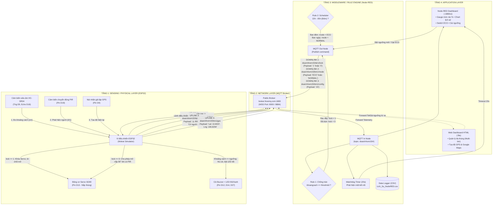

# SƠ ĐỒ LUỒNG DỮ LIỆU END-TO-END (E2E) 4 TẦNG IOT
**Đề tài:** Hệ thống Thùng rác thông minh quản lý tập trung qua mạng lưới IoT  
**Mã nhóm:** Nhóm 15 | **Cột mốc:** Milestone M4 (Tuần 8)

---

## 1. SƠ ĐỒ TỔNG THỂ KIẾN TRÚC 4 TẦNG & LUỒNG 2 CHIỀU

---

## 2. BẢNG TRA CỨU ĐƯỜNG ĐI GÓI TIN (TOPIC & PAYLOAD MAP)

### A. Luồng Uplink (Thiết bị $\rightarrow$ Mạng $\rightarrow$ Middleware $\rightarrow$ Ứng dụng)
| STT | Cảm biến nguồn | Topic MQTT | Payload mẫu | Tần suất | Mục đích & Nơi xử lý |
| :---: | :--- | :--- | :--- | :--- | :--- |
| **1** | HC-SR04 | `doan/nhom15/bin1/khoangcach` | `"4.20"` | 3s (Normal) / 30s (ECO) | Node-RED vẽ gauge, chart; kiểm tra Rule 1 khóa nắp; Web đổi màu cột rác. |
| **2** | Giả lập Pin | `doan/nhom15/bin1/battery` | `"85"` | Cùng nhịp khoảng cách | Dashboard hiển thị dung lượng pin còn lại. |
| **3** | PIR / Sự kiện | `doan/nhom15/bin1/canhbao` | `"Có người đến gần! Đang mở nắp..."` hoặc `"⚠️ KHẨN CẤP: RÁC ĐẦY"` | Theo sự kiện (Event-driven) | Dashboard nảy Toast cảnh báo; Node-RED đếm lượt mở nắp và ghi log CSV. |
| **4** | Nút bấm GPS | `doan/nhom15/bin1/gps` | `"Lat: 10.8037, Lng: 106.6294"` | Khi nhấn nút | Web Dashboard hiện nút liên kết Google Maps vị trí thùng rác. |

---

### B. Luồng Downlink (Ứng dụng / Middleware $\rightarrow$ Mạng $\rightarrow$ Cơ cấu chấp hành)
| STT | Nguồn phát lệnh | Topic MQTT | Payload | Cơ cấu chấp hành nhận lệnh | Hành vi phản ứng tại hiện trường |
| :---: | :--- | :--- | :---: | :--- | :--- |
| **1** | Node-RED (Rule 1) | `doan/nhom15/bin1/lock` | `"1"` | Động cơ Servo SG90 + Còi Buzzer | **Khóa nắp chống tràn:** ESP32 đặt cờ `lid_locked = true`. Khi PIR kích hoạt, Servo **không mở**, còi hú ngắn cảnh cáo người dùng. |
| **2** | Node-RED (Rule 1) | `doan/nhom15/bin1/lock` | `"0"` | Động cơ Servo SG90 | **Mở khóa thùng:** Khi dọn rác ($d > \text{ngưỡng} + 3\text{cm}$), ESP32 giải phóng nắp, PIR mở nắp được bình thường. |
| **3** | Node-RED (Rule 2) / Switch | `doan/nhom15/bin1/mode` | `"ECO"` | Vòng lặp vi điều khiển ESP32 | **Tiết kiệm năng lượng:** ESP32 giãn chu kỳ gửi telemetry từ 3s lên 30s để giảm tiêu thụ điện. |
| **4** | Dashboard (UI) | `doan/nhom15/bin1/config` | `"15"` | Bộ nhớ RAM ESP32 | **Đổi ngưỡng báo đầy từ xa:** ESP32 cập nhật `distance_threshold = 15`. Ngay sau đó nếu rác $\le 15\text{cm}$ còi sẽ hú ngay. |

---

## 3. VÍ DỤ TRUY VẾT 2 KỊCH BẢN ĐIỂN HÌNH

### Kịch bản 1: Luồng Uplink $\rightarrow$ Downlink tự động (Chống tràn rác)
$$\text{Rác chạm mốc 3cm} \xrightarrow{\text{HC-SR04}} \text{ESP32} \xrightarrow[\text{Payload: '3.00'}]{\text{topic: .../khoangcach}} \text{Broker} \xrightarrow{} \text{Node-RED}$$
$$\text{Node-RED: Rule 1 kích hoạt} \xrightarrow[\text{Payload: '1'}]{\text{topic: .../lock}} \text{Broker} \xrightarrow{} \text{ESP32} \xrightarrow{\text{Cập nhật lid\_locked}} \text{Servo KHÓA}$$

### Kịch bản 2: Luồng Downlink can thiệp từ người quản trị (Remote Command)
$$\text{Người quản lý nhập số 12} \xrightarrow{\text{Dashboard UI}} \text{Node-RED} \xrightarrow[\text{Payload: '12'}]{\text{topic: .../config}} \text{Broker} \xrightarrow{} \text{ESP32}$$
$$\text{ESP32: callback() gán distance\_threshold = 12} \xrightarrow{} \text{Lập tức so sánh với cảm biến HC-SR04}$$
